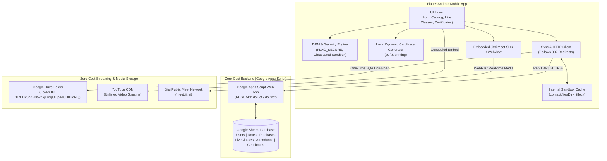

# System Architecture & Technical Specifications (v2.0)
## Project: TutorFlow SecureNotes & Mini-LMS
**Lead Developer:** Abhishek Maheshwari | Prince Electronics & Electricals, Bilsi  
**Database (Sheet ID):** `1AKGL9CXjkpGAdO3k22l8cmpHUgVAWfLTajzPg7GT6CI`  
**Storage (Drive Folder ID):** `1RHH23n7u3bwZkjlDeqI9FjoJoCH0DdNQ`  

---

## 1. End-to-End System Topology



---

## 2. Updated Google Sheets Relational Schema

| Tab Name | Key Columns | Purpose |
| :--- | :--- | :--- |
| **`Users`** | `user_id`, `name`, `email`, `phone`, `password_hash`, `is_admin`, `created_at` | Student & Admin authentication table |
| **`Notes`** | `note_id`, `title`, `subject`, `semester`, `description`, `price`, `drive_file_id`, `youtube_video_id`, `is_active`, `created_at` | Course catalog & BCA note metadata |
| **`Purchases`** | `purchase_id`, `user_id`, `note_id`, `status` (`ACTIVE`/`PENDING`), `txn_reference`, `unlocked_at` | Monetization & access control |
| **`LiveClasses`** | `class_id`, `title`, `instructor`, `subject`, `meeting_type` (`JITSI`/`MEET`/`ZOOM`), `meeting_room_or_url`, `schedule_time`, `is_active` | Scheduled live lectures |
| **`Attendance`** | `attendance_id`, `user_id`, `user_name`, `session_id`, `session_title`, `session_type`, `timestamp` | Automated audit ledger |
| **`Certificates`**| `certificate_id`, `user_id`, `user_name`, `course_title`, `issue_date`, `verification_hash`, `instructor` | Digital credentials record |

---

## 3. Extended Google Apps Script API Specification

All POST requests send JSON bodies and receive JSON responses. HTTP clients must follow 302 redirects.

### 3.1 Attendance Logging (`action: "mark_attendance"`)
* **Request:**
  ```json
  {
    "action": "mark_attendance",
    "user_id": "usr_94b8e21a",
    "user_name": "Alex Student",
    "session_id": "live_817283",
    "session_title": "BCA Data Structures Lecture 4",
    "session_type": "LIVE_CLASS"
  }
  ```
* **Response:**
  ```json
  {
    "status": "success",
    "message": "Attendance recorded successfully",
    "attendance_id": "att_198273"
  }
  ```

### 3.2 Live Classes Retrieval (`action: "get_live_classes"`)
* **Request:**
  ```json
  {
    "action": "get_live_classes",
    "user_id": "usr_94b8e21a"
  }
  ```
* **Response:**
  ```json
  {
    "status": "success",
    "data": [
      {
        "class_id": "live_001",
        "title": "C Programming Pointers & Dynamic Memory",
        "instructor": "Abhishek Maheshwari",
        "subject": "Programming in C",
        "meeting_type": "JITSI",
        "meeting_room_or_url": "TutorFlow_BCA_Class_9021",
        "schedule_time": "2026-11-15T18:00:00Z",
        "is_active": true
      }
    ]
  }
  ```

### 3.3 Dynamic Certificate Issuance (`action: "generate_certificate"`)
* **Request:**
  ```json
  {
    "action": "generate_certificate",
    "user_id": "usr_94b8e21a",
    "user_name": "Alex Student",
    "course_title": "BCA Data Structures & Algorithms"
  }
  ```
* **Response:**
  ```json
  {
    "status": "success",
    "data": {
      "certificate_id": "TF-BCA-847291",
      "issue_date": "2026-11-12",
      "verification_hash": "e8a91b2c4f8d92a1",
      "instructor": "Abhishek Maheshwari"
    }
  }
  ```
