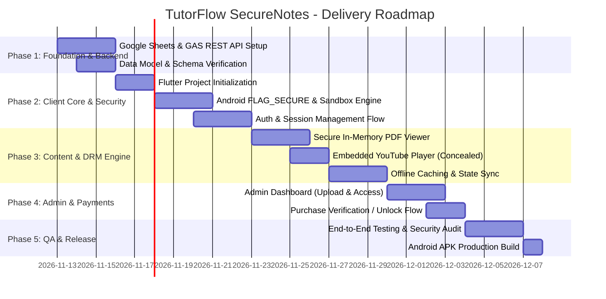

# Master Project Plan & Execution Roadmap
## Project: TutorFlow SecureNotes (Zero-Cost LMS)
**Role:** Technical Project Manager to the CEO  
**Target Delivery Window:** 3 Weeks (Sprint-based Execution)  
**Status:** Approved for Kickoff  

---

## 1. Project Overview & Strategic Objectives

The goal of this initiative is to launch a zero-operating-cost, highly protected educational content delivery platform (Android Flutter application + Google Sheets / Apps Script backend) within 21 calendar days. 

---

## 2. Work Breakdown Structure (WBS)

### Phase 1: Zero-Cost Backend Infrastructure (Days 1–3)
- **Task 1.1:** Initialize master Google Sheet (`TutorFlow_Backend`) with tabs: `Users`, `Notes`, `Purchases`.
- **Task 1.2:** Write and test Google Apps Script (GAS) Web App implementing `doGet` and `doPost` endpoints.
- **Task 1.3:** Implement password hashing with SHA-256 inside GAS.
- **Task 1.4:** Deploy GAS as Web App with public access (`Anyone`), securely handling CORS headers and JSON payloads.
- **Task 1.5:** Create Google Drive repository structure and set link permissions to "Anyone with the link can view".

### Phase 2: Client Core, Authentication & Sandbox (Days 4–8)
- **Task 2.1:** Scaffold Flutter application with clean architectural separation (Domain, Data, Presentation).
- **Task 2.2:** Configure Android native layer:
  - Add `WindowManager.LayoutParams.FLAG_SECURE` in `MainActivity.kt` and via `flutter_windowmanager`.
  - Configure Android Manifest permissions (`INTERNET`, `ACCESS_NETWORK_STATE`).
- **Task 2.3:** Implement API client with retry and error-handling mechanisms for Google Apps Script redirects (HTTP 302).
- **Task 2.4:** Build Authentication screens (Sign In, Sign Up, Session Token Local Cache).

### Phase 3: DRM Content Viewers & Offline Caching (Days 9–14)
- **Task 3.1:** Implement Secure Downloader:
  - Direct stream from Google Drive download link into private application sandbox (`context.filesDir` / `path_provider`).
  - Obfuscate filename extension (e.g. `doc_9482.tflock`) to prevent accidental indexing by third-party apps.
- **Task 3.2:** Build In-Memory PDF Viewer:
  - Read bytes directly from private sandbox file into memory.
  - Disable text copying, printing, and screenshotting.
  - Smooth page navigation, zoom, and bookmarking.
- **Task 3.3:** Build Concealed YouTube Player:
  - Embed YouTube player (`youtube_player_flutter` or webview controller).
  - Strip top-bar sharing, "Watch on YouTube" watermarks, and related video distractions.
- **Task 3.4:** Build Offline Manager:
  - Check local disk cache before attempting network download.
  - Display storage usage and "Clear Cache" button in student settings.

### Phase 4: Admin Controls & Payment Verification (Days 15–18)
- **Task 4.1:** Build Admin Dashboard inside the app (protected by `is_admin == true`).
- **Task 4.2:** Admin Note Publisher form (Title, Subject, Drive File ID, YouTube Video ID, Price).
- **Task 4.3:** Student Enrollment & Purchase Management Table:
  - View pending payment references.
  - One-tap toggle to flip purchase status to `ACTIVE`.
- **Task 4.4:** Student Purchase Workflow:
  - Catalog paywall trigger.
  - Display payment QR / UPI ID, reference submission form, and pending status banner.

### Phase 5: Hardening, QA & Release (Days 19–21)
- **Task 5.1:** Security penetration testing:
  - Verify screen recorder attempts result in a black screen.
  - Verify Android Device File Explorer cannot inspect or access sandbox files on non-rooted phones.
  - Confirm internal files never show in phone gallery, WhatsApp attachments, or file managers.
- **Task 5.2:** Stress-test Google Apps Script response times and rate limits.
- **Task 5.3:** Build Release APK / App Bundle with ProGuard/R8 code shrinking and obfuscation.

---

## 3. Risk Assessment Matrix & Mitigation Strategies

| Risk Description | Severity | Likelihood | Mitigation Strategy |
| :--- | :---: | :---: | :--- |
| **Google Drive Download Throttling** (Multiple concurrent downloads exceed Drive limits) | High | Medium | **1.** Offline cache on first access ensures download happens only once per device. **2.** Stagger download cues or mirror files across 2 backup Drive accounts if needed. |
| **Google Apps Script HTTP 302 Redirect Handling** (Flutter HTTP clients can fail on Apps Script redirects) | High | High | Enable automatic redirect following (`followRedirects: true` with max 5 redirects) in `http` or `dio` network client. |
| **Bypass of `FLAG_SECURE` on Rooted Devices** | Low | Low | Acknowledge hardware reality: acceptable business risk for 99% mass-market student audience. Add optional root-detection package (`flutter_jailbreak_detection`). |
| **Google Apps Script Daily Quota** (Script execution limits exceeded during rush hour) | Medium | Low | Cache note catalog JSON locally in `shared_preferences` / Hive with a 30-minute refresh window; only hit backend for purchase validation and downloads. |
| **YouTube Video Link Scraping** | Medium | Medium | Use custom player controls and disable native video title links; keep videos Unlisted so they do not show in YouTube search algorithms. |

---

## 4. Key Performance Indicators (KPIs)

1. **Zero Cloud Infrastructure Invoices:** \$0.00 spent on AWS, GCP, Supabase, or Firebase database services.
2. **First-Time Load Latency:** Course catalog rendered within $\le 1.8$ seconds on standard 4G mobile networks.
3. **Offline Reliability:** 100% of unlocked cached notes must open instantly without an active internet connection.
4. **Content Leakage:** 0% unencrypted PDF files accessible in public file managers (`/sdcard/Download`).

